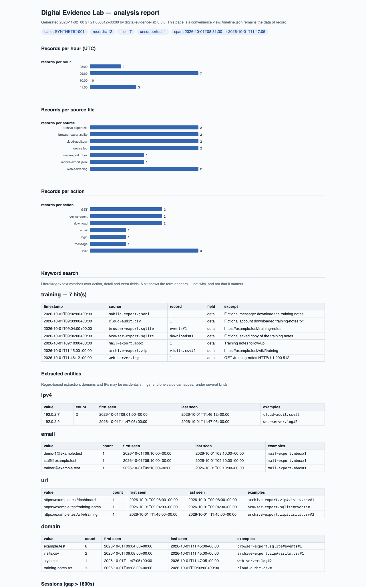

# Digital Evidence Lab

A small Python lab for collecting **logical file copies**, checking their integrity and building an analysed timeline from exported records. Created on **29 October 2026** as a portfolio exercise and extended with AI assistance (v0.2 on 31 October, v0.3 on 1 November). It demonstrates the software below; it does not establish earlier forensic employment, independent specialist-tool proficiency or a completed forensic course.



## See it in 30 seconds

Python 3.11+ on macOS or Linux; **no third-party packages or API keys**.

```sh
pip install -e .            # optional; gives you the `evidence-lab` command
evidence-lab demo           # generate → collect → verify → analyse → open the report
```

Without installing, from a checkout:

```sh
python3 -m evidence_lab demo --no-open
```

The demo generates a fictional case (8 files: cloud-audit CSV, mobile JSONL, two-table SQLite, mbox mailbox, RFC 5424 syslog, Apache access log, a zip of CSV exports — plus a hash-set sidecar), collects it with a hash-chained custody log, verifies every byte, analyses twelve records across four parsers' worth of formats, and opens a self-contained HTML report with inline SVG charts. Every byte is generated locally; nothing touches a real device, mailbox or account.

## The full workflow

```sh
python3 make_demo.py demo-source demo-hashset.csv
python3 -m evidence_lab collect demo-source demo-case --operator "Training operator" --case-id SYNTHETIC-001 --jobs 4
python3 -m evidence_lab verify demo-case
python3 -m evidence_lab timeline demo-case demo-analysis \
  --keywords training --session-gap 1800 --hashset demo-hashset.csv
python3 -m evidence_lab search demo-case training
```

Files produced:

```text
demo-case/
  evidence/          # copies, never analysis output
  manifest.json      # file digests, sizes and observed source modification times
  handling.jsonl     # ordered, hash-linked collection events with operator/time
  anchor.json        # manifest and final handling-log hashes
demo-analysis/
  timeline.json
  timeline.csv
  report.json        # scope, unsupported files, field mappings, analysis, limits
  report.html        # self-contained view with inline SVG charts (no JS, no assets)
```

## What the parsers do

Format detection is by filename suffix (with `.gz`/`.zip` unwrapping to the inner name). Fields are mapped to `timestamp`/`action`/`detail` either automatically (column-name candidates plus value sniffing) or by an explicit mapping file:

```json
{
  "calls.csv": {"timestamp": "when", "action": "direction", "detail": "note", "extra": ["tower"]},
  "*.ndjson": {"timestamp": "ts", "action": "event", "detail": "msg"}
}
```

| Input | Behaviour |
| --- | --- |
| CSV, JSONL/NDJSON | header/key auto-detection or `--mapping` file; unmapped columns kept in `extra` |
| SQLite (`.sqlite`, `.db`) | all user tables discovered read-only (`mode=ro&immutable=1`); records identified as `table#rowid` |
| mbox | message headers only (Date/From/To/Subject/Message-ID); bodies are not indexed |
| Syslog (`.log`, `.syslog`) | simplified RFC 5424 natively; RFC 3164 only with declared `--assume-offset`/`--assume-year` |
| Apache/nginx combined log | regex over the combined format; the format itself carries the offset |
| gzip / zip members | decompressed and parsed by inner name; members are `name#record`, encrypted members refused |
| anything else | listed under `unsupported_files`, never silently analysed |

Timestamps must be timezone-aware or the run fails; the only exceptions are RFC 3164 lines under explicitly declared assumptions, which the report then discloses under `timestamp_assumptions`. Every mapping actually used is recorded under `field_mappings`.

## What the analysis does — and what it is

`timeline` verifies the case, extracts records, then reports:

- **Keyword search** (`--keywords a,b`, `--keywords-file`, `--regex`): per-term hit counts with capped, provenance-carrying matches. A hit shows the text appears — not why, and not that it matters.
- **Entity extraction** (always on): IPv4, email, URL, domain and SHA-256-looking strings via regex. Domains may be incidental filenames; one value can appear under several kinds.
- **Sessions** (`--session-gap SECONDS`): records grouped wherever the silence between consecutive events exceeds the threshold. The threshold is arbitrary; gaps are not proof of anything.
- **Histogram and counts**: contiguous per-hour UTC buckets plus per-source/per-action counts, drawn as inline SVG in `report.html`.
- **Hash-set classification** (`--hashset known.csv` with a `sha256[,label,notes]` header): labels collected files whose digests appear in the sidecar. It says the bytes were known to you, nothing more.

`search` runs one keyword query over a verified case without writing an analysis directory, and accepts the same `--mapping` file as `timeline`.

`collect` never overwrites an existing case. It refuses overlapping paths, symbolic links and non-regular inputs, compares source metadata before/after copying, independently rehashes each destination and marks caught failures or keyboard interruptions incomplete. Abrupt termination such as SIGKILL cannot write that marker; missing completion metadata still prevents verification. `--jobs N` parallelises copying and hashing while keeping the handling log in deterministic sorted order. Reading can update filesystem access times: this is **not write-blocked acquisition** and does not preserve every filesystem attribute.

`verify` rejects changed, missing or additional evidence, altered or truncated handling logs, duplicate paths and mismatches between copy events and the manifest. `timeline` and `search` verify before **and** after extraction, open SQLite in read-only immutable mode, require timezone-aware timestamps and write outside the case.

## Terminal experience

Output is machine-first: every command except `demo` prints one JSON document (`{"ok": ...}`) and exits 0/1, so pipelines can rely on it. Human polish is additive and never contaminates the JSON:

- progress bars render on stderr when attached to a terminal (`--progress` forces, `--no-progress` disables);
- colour follows the [NO_COLOR](https://no-color.org) convention, `TERM=dumb` and non-TTY detection (`--no-color` forces off);
- `--verbose` prints per-file lines instead of the bar.

## What the hashes do—and do not—prove

The handling log is hash-linked, not signed, externally timestamped or protected against privileged rewriting. A person who can replace the entire case can recompute all local hashes. Retain the two hashes returned by `collect` in an independent trusted location, then provide them during verification:

```sh
python3 -m evidence_lab verify demo-case \
  --expected-manifest MANIFEST_SHA256 \
  --expected-handling HANDLING_SHA256
```

Those command arguments must be the actual returned values, not the illustrative names above. Local hash agreement checks internal consistency. It does not prove the original source was truthful, identify a human custodian or establish legal admissibility. A sorted timeline is not proof of causation, and source clocks may be wrong.

## Design reference

[NIST SP 800-86, section 3.2 and Appendix A](https://nvlpubs.nist.gov/nistpubs/legacy/sp/nistspecialpublication800-86.pdf) discusses preserving copied data, checking integrity and documenting collection actions. This exercise applies those ideas to a narrow logical-file workflow. It is **not certified, standards-compliant forensic acquisition** or a substitute for an organisation's forensic practices and protocols.

## Scope and evidence boundaries

- Implemented: Python file copying, SHA-256 checks (optionally parallel), handling-event hash chains, CSV/JSONL/SQLite/mbox/syslog/Apache/gzip/zip extraction, configurable field mapping, UTC timeline analysis, keyword/entity/session analysis, provenance reporting in JSON/CSV/HTML.
- Demonstrated on synthetic exports representing mobile devices, cloud activity and personal computer systems; **no actual device acquisition** or live cloud collection is implemented.
- No physical disk imaging, deleted-file recovery, filesystem carving, device unlocking, professional chain-of-custody system or independent tool validation.
- No EnCase, Cellebrite, X-Ways, MS Access or Visual Basic integration. These names describe exclusions, not experience or skills.
- Use only the supplied synthetic fixtures or data you own and are authorised to examine. This educational parser is not hardened to process hostile evidence or large volumes; collection is not an atomic filesystem snapshot. Stable source directories and a trusted local operator are assumed.

See [the tests](tests/test_evidence_lab.py) for tampering, truncation, path/symlink, timestamp, source-preservation, parser, mapping, analysis, terminal-polish and parallelism checks (38 cases). [The example report](examples/report.json), [timeline](examples/timeline.csv) and [HTML view](examples/report.html) are actual outputs from the supplied synthetic scenario. Changes are tracked in [the changelog](CHANGELOG.md).

The [method and review worksheet](docs/method-and-review.md) explains the lab procedure, provenance checks and limits on conclusions.

## Engineering

```text
evidence_lab/         core · collect · verify · parsers · analysis · reporting · demo · ui · cli
make_demo.py          compatibility shim for the packaged scenario generator
tests/                38 unittest cases, stdlib only
docs/                 method and review worksheet · report screenshot
examples/             actual outputs from the demo scenario
```

- Type-annotated; `ruff check`, `ruff format`, `mypy` and a coverage gate (≥85%) run in CI alongside the test matrix (Ubuntu + macOS, Python 3.11–3.14).
- The version is single-sourced from `evidence_lab.core.VERSION` into the package metadata; tagging `vX.Y.Z` builds distributions and publishes a GitHub release ([release workflow](.github/workflows/release.yml)).

## Attribution

Requested by Aman Kumar Sah; v0.1 implemented with Codex assistance on 29 October 2026, v0.2 on 31 October and v0.3 on 1–2 November 2026. Test and demonstration execution were performed by the coding agent. The repository is dated new work; it makes no claim that the owner independently wrote every line or operated commercial forensic tools.

MIT licensed; see [LICENSE](LICENSE).
